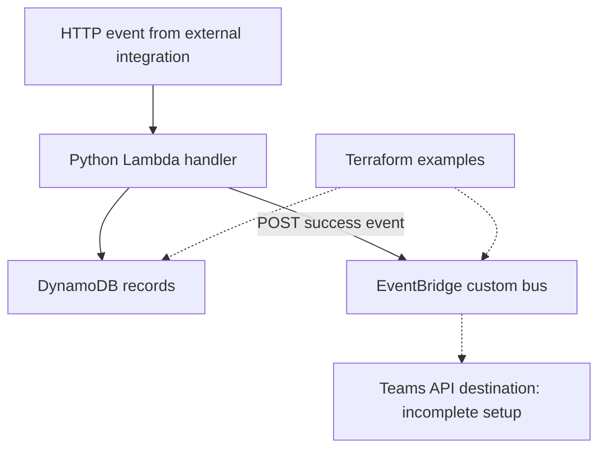

# DynamoDB CRUD and EventBridge Example

A Python Lambda handler for reading, creating, updating and deleting DynamoDB records. Successful POST operations also publish a custom EventBridge event; Terraform examples define the tables, event bus and a Teams API destination.

**Status:** An incomplete integration example. Lambda/API Gateway provisioning, referenced Terraform modules, the notification template and local secrets need configuration or completion.

## Architecture

## Start here

Read [lambda/index.py](lambda/index.py) for the request contract and [terraform/](terraform/) for infrastructure definitions. The handler accepts GET, POST, PATCH and DELETE on `/dynamo`. EventBridge events are emitted by the handler after POST; this branch does not implement a DynamoDB Streams consumer.

[Previous README and detailed reference](https://github.com/mtzanida/crud-operations-with-dynamo/blob/4c20fce9958411111f1b5e6612939abe545f825e/README.md) are retained in Git history. They may describe older assumptions or unmerged plans; the scope above reflects this branch.
